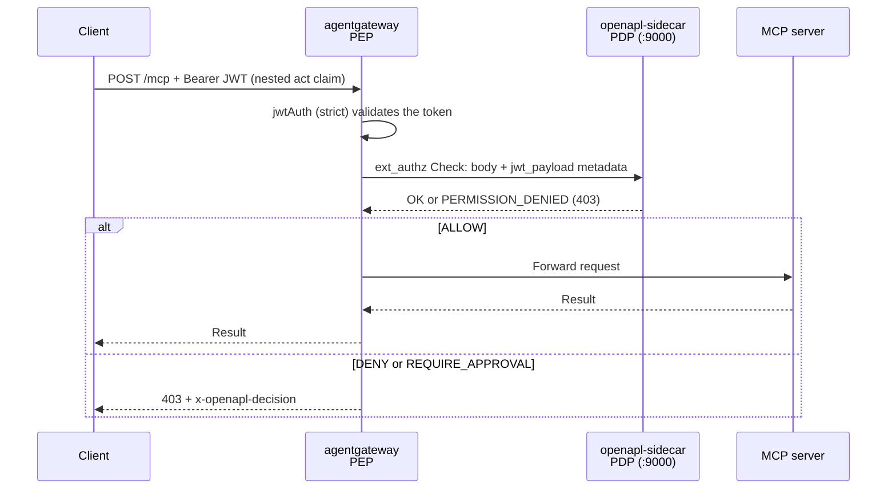

## MCP Tool Authorization with OpenAPL

[OpenAPL](../../README.md) is an access policy language for humans and AI
agents. It evaluates the whole delegation chain of a request (the human who
started the work, every agent it passed through, and the agent calling the
tool) and answers `ALLOW`, `DENY` or `REQUIRE_APPROVAL`, with the reasons and
control references behind the decision. The `openapl-sidecar` puts that
decision engine behind Envoy `ext_authz` (gRPC) and AuthZEN 1.0 (HTTP).

In this guide agentgateway is the Policy Enforcement Point in front of MCP
servers. It validates the caller's JWT, passes the verified claims and the
request body to the sidecar, and forwards a `tools/call` only if the sidecar
allows it.



A runnable version of this guide is in [`demo/agentgateway`](../../demo/agentgateway/README.md).

### Before you begin

- agentgateway v1.7.0 (the version this guide was checked against).
- A JWT issuer whose tokens carry `email`, `groups`, `iat`, `exp`, and for
  delegation the `openapl_purpose`, `openapl_task_id`, `openapl_approvals` and
  a nested `act` claim (outermost `act` is the current caller). Each `act.sub`
  must equal the identity value used in the policy.
- An OpenAPL policy directory and, optionally, a bindings file.
- Python 3.11 with the packages in `demo/agentgateway/requirements.txt` (and the SDK, `pip install ./sdk`), or the `sidecar/.venv`, for the demo issuer and the Verify commands.
- The sidecar image. It is not published; build it from the repository root:

```bash
docker build -f sidecar/Dockerfile -t openapl-sidecar:dev .
```

### 1. Run the sidecar

```yaml
services:
  ext-authz:
    image: openapl-sidecar:dev
    environment:
      OPENAPL_PDP_TOKEN: change-me          # AuthZEN bearer token (the demo uses the literal demo-token)
      OPENAPL_POLICY_DIR: /config/policies
      OPENAPL_BINDINGS: /config/bindings.yaml
      OPENAPL_DIRECTORY_SNAPSHOT: /config/directory.json   # optional: owner status for orphan checks
      OPENAPL_DECISION_LOG: /out/decisions.jsonl           # optional: JSONL decision log
    volumes:
      - ./policies:/config/policies:ro
      - ./bindings.yaml:/config/bindings.yaml:ro
      - ./directory.json:/config/directory.json:ro
      - ./out:/out
```

The sidecar listens on 9000 (ext_authz gRPC) and 8081 (AuthZEN HTTP), runs as
uid 10001 (so the decision log directory must be writable by it) and exposes
`/healthz` on 8081. Do not publish port 9000.

> **Keep port 9000 private.** It trusts the claims metadata its caller sends
> and cannot authenticate the caller. Anyone who can reach it can forge
> claims. Put it on a private network reachable only by the gateway.

### 2. Describe your tools in a bindings file

A bindings file maps an MCP tool call onto the action, resource and
attributes the policy sees.

```yaml
version: 1
targets: [payments, crm]
prefix_mode: always
tools:
  - tool: refund_order
    target: payments
    action: payments.refund
    resource: "order/${args.order_id}"
    attributes: { order_id: "${args.order_id}", amount: "${args.amount}", account_status: "${args.account_status}" }
  - tool: void_payment
    target: payments
    action: payments.void
    resource: "payment/${args.payment_id}"
```

With more than one target, agentgateway names tools `<target>_<tool>`, and the
sidecar splits on the first `_`, so target names must not contain `_`.
`prefix_mode` mirrors agentgateway's `prefixMode` and must match it
(`conditional`, `always` or `never`). A tool with no binding gets the default
action `mcp.tools.call:${target}/${tool}`. A placeholder whose argument is
missing denies the call.

### 3. Configure agentgateway

```yaml
# yaml-language-server: $schema=https://agentgateway.dev/schema/config
mcp:
  port: 3000
  prefixMode: always
  policies:
    jwtAuth:
      mode: strict
      issuer: https://issuer.demo.openapl.local
      audiences: [agentgateway-demo]
      jwks:
        file: /config/out/jwks.json
    extAuthz:
      host: ext-authz:9000
      protocol:
        grpc: {}
      includeRequestBody:
        maxRequestBytes: 65536
        allowPartialMessage: false
  targets:
  - name: payments
    mcp:
      host: http://payments-mcp:3001/mcp
  - name: crm
    mcp:
      host: http://crm-mcp:3002/mcp
```

What each part does:

- **`jwtAuth` with `mode: strict`.** Rejects a request with no token or a bad
  token with 401, before ext_authz runs. This is required: the sidecar allows
  passthrough methods (`initialize`, `tools/list`, notifications, GET) without
  claims, so authentication on the route must be mandatory. Tokens need `exp`.
- **Claims delivery.** With no `protocol.grpc.metadata` set, the verified claims
  reach the sidecar as `filter_metadata["envoy.filters.http.jwt_authn"]["jwt_payload"]`,
  where it looks by default (`OPENAPL_CLAIMS_METADATA`).
- **`includeRequestBody`.** The sidecar decides on the JSON-RPC body. Without it
  the body is empty and the sidecar denies. Set `maxRequestBytes` above your
  largest expected `tools/call`: the default (8192) is small. In v1.7.0 a body over
  the limit is refused by the gateway with 413 and never reaches the sidecar;
  keep `allowPartialMessage: false` so a truncated body is never passed on.
- **`failureMode`** is left unset, so the deny default applies. If you set it,
  use `deny`.

> **Do not gate `extAuthz` on `has(mcp.tool)`.** If the tool prefix cannot be
> resolved, `mcp.tool` is unset and the policy would be skipped, which fails
> open. The sidecar must see every MCP POST.

> **Set `maxRequestBytes`.** Size it for your tool arguments, and keep it below
> what you are willing to buffer per request.

### 4. Start it

```bash
rm -rf demo/agentgateway/out && mkdir demo/agentgateway/out
chmod 0777 demo/agentgateway/out    # the sidecar runs as uid 10001 and must write decisions.jsonl here
python demo/agentgateway/issuer.py keys demo/agentgateway/out   # demo issuer; use your IdP in production
docker compose -f demo/agentgateway/compose.yaml up -d --build --wait
```

### Verify

The commands below use the demo issuer to mint tokens from `scenarios.yaml`.

A request without a token is rejected by the gateway:

```bash
curl -s -o /dev/null -w '%{http_code}\n' -X POST http://127.0.0.1:3000/mcp \
  -H 'content-type: application/json' -H 'accept: application/json, text/event-stream' \
  -d '{"jsonrpc":"2.0","id":1,"method":"tools/list"}'
# 401
```

Open a session, then call a tool the delegation chain does not allow:

```bash
cd demo/agentgateway
TOKEN=$(python issuer.py token --scenario deny-attenuation --scenarios scenarios.yaml --out-dir out)
H=(-H "authorization: Bearer $TOKEN" -H 'content-type: application/json' -H 'accept: application/json, text/event-stream')
curl -s -D out/h.txt -o /dev/null -X POST http://127.0.0.1:3000/mcp "${H[@]}" \
  -d '{"jsonrpc":"2.0","id":1,"method":"initialize","params":{"protocolVersion":"2025-03-26","capabilities":{},"clientInfo":{"name":"curl","version":"0"}}}'
SID=$(grep -i '^mcp-session-id' out/h.txt | awk '{print $2}' | tr -d '\r')
curl -s -o /dev/null -X POST http://127.0.0.1:3000/mcp "${H[@]}" -H "mcp-session-id: $SID" \
  -d '{"jsonrpc":"2.0","method":"notifications/initialized"}'
curl -s -i -X POST http://127.0.0.1:3000/mcp "${H[@]}" -H "mcp-session-id: $SID" \
  -d '{"jsonrpc":"2.0","id":2,"method":"tools/call","params":{"name":"payments_void_payment","arguments":{"payment_id":"p1"}}}'
```

```
HTTP/1.1 403 Forbidden
x-openapl-decision: DENY
x-openapl-decision-id: <id>
content-type: application/json

{"decision": "DENY", "reasons": ["no delegation edge support-agent -> refund-agent for payments.void", ...], "approvers": [], "decision_id": "<id>", "decision_ids": ["<id>"]}
```

The decision is also a new line in `out/decisions.jsonl`. The sidecar
ports are not reachable from the host (only `127.0.0.1:3000` is published).
To run all 13 scenarios instead, use `./demo/agentgateway/run.sh`.

### Alternative: AuthZEN over HTTP

If you prefer the standard API, the sidecar also serves AuthZEN 1.0 on port
8081 (`POST /access/v1/evaluation`, bearer token `OPENAPL_PDP_TOKEN`). The
gateway side then looks like agentgateway's own
[`mcp-authzen` example](https://github.com/agentgateway/agentgateway/tree/main/examples/mcp-authzen):
an `extAuthz` with `protocol.http`, a request body built from the validated
JWT and `mcp.tool`, and a rule on the decision.

This path was not exercised in the demo. Two differences from the gRPC path
matter: the sidecar needs the verified claims in `context.claims` and
`subject.id` equal to the claims identity (`email`), and the evaluation
sees only what you map into it, so tool arguments must be mapped into
`resource.properties` to be decided on. Prefer the gRPC path when you want
decisions on the raw MCP body.

### Known difference: JSON-RPC batches

agentgateway v1.7.0 rejects a JSON-RPC batch (an array) with `400 fail to
deserialize request body: unrecognized JSON-RPC message`, but only after
ext_authz has seen the body. The sidecar decides every `tools/call` in a batch
and denies the whole request if one is denied (403), so a denied call cannot
ride along in a batch. See [VERIFIED.md](../../demo/agentgateway/VERIFIED.md).

### Cleanup

```bash
cd ../..   # back to the repository root if you ran Verify from demo/agentgateway
docker compose -f demo/agentgateway/compose.yaml down -v
```

### Verified with

agentgateway v1.7.0 (`ghcr.io/agentgateway/agentgateway:v1.7.0`). The wire
facts (per-message checks, body, claims, `act` order, size limit, no-token)
are recorded in [`VERIFIED.md`](../../demo/agentgateway/VERIFIED.md).

### References

- [Sidecar reference](../../sidecar/README.md)
- [AuthZEN Authorization API 1.0](https://openid.net/specs/openid-authzen-authorization-api-1_0-ID1.html)
- [agentgateway `mcp-authzen` example](https://github.com/agentgateway/agentgateway/tree/main/examples/mcp-authzen)
